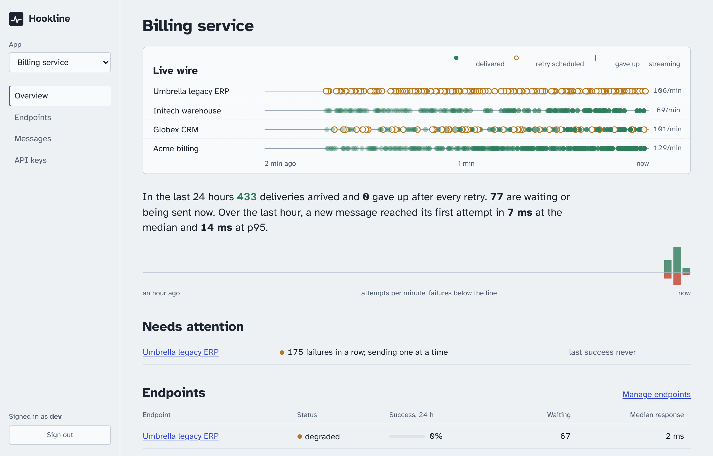
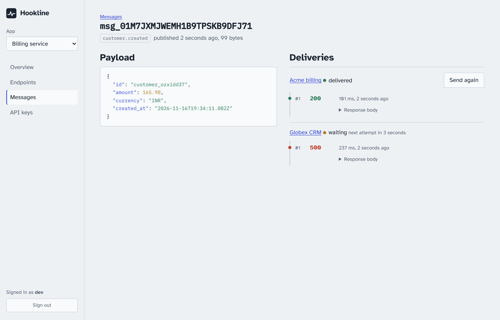
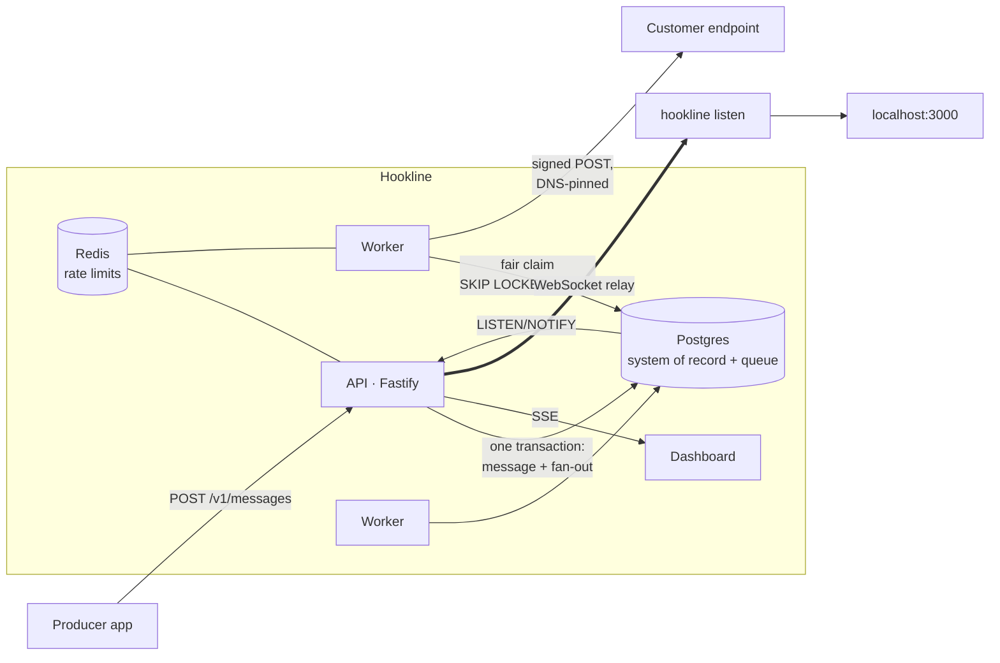

# Hookline

**Self-hostable webhook delivery that you can prove doesn't lose events.** Your app publishes an
event once; Hookline signs it, delivers it to every subscribed customer endpoint, retries with
backoff for up to ~23 hours, keeps one slow customer from delaying everyone else, and shows you
every attempt live.



**Measured, not claimed:** 8,000 deliveries to four misbehaving endpoints while a worker was
SIGKILLed every 4 seconds (34 kills): **0 lost**, 148 duplicates (1.85%, the expected cost of
at-least-once), 0 bad signatures. 2-CPU sandbox, everything on one machine; method, all runs and
caveats in [docs/MEASUREMENTS.md](docs/MEASUREMENTS.md).

## What it does

- **At-least-once delivery, crash-safe.** Deliveries live in Postgres and are claimed under a
  lease (`FOR UPDATE SKIP LOCKED`). Kill a worker mid-request and a reaper returns its work to the
  queue. The torture test does exactly that, repeatedly, and checks the receiver's ledger.
- **Fair under load.** A flooded or slow endpoint gets a bounded number of in-flight slots, so a
  healthy endpoint's deliveries keep moving ([ADR 0005](docs/adr/0005-fair-claiming.md)).
- **Signed with [Standard Webhooks](https://www.standardwebhooks.com).** HMAC-SHA256 over
  `id.timestamp.body`, secret rotation with dual signatures for 24 h, verified against the spec's
  published test vector.
- **Retries that respect the receiver.** 10 attempts over ~23 h with ±20% jitter, honours
  `Retry-After` on 429/503, treats `410 Gone` as "stop sending", never follows redirects.
- **Circuit breaker.** After 5 consecutive failures an endpoint is sent one request at a time; after
  5 days without a success it is disabled and shown under "Needs attention".
- **SSRF protection that survives DNS rebinding.** The private-address check runs inside the
  socket's own DNS lookup, so the address that passed is the address connected to.
- **Idempotent ingest.** `Idempotency-Key` returns the original message; the same key with a
  different body is a 409, including when ten identical requests race.
- **`hookline listen`.** Receive webhooks on `localhost` with no tunnel: the CLI holds a
  WebSocket and gets deliveries through the same queue, retries and attempt log as a public
  endpoint ([ADR 0006](docs/adr/0006-cli-relay-transport.md)).
- **Live everything.** Postgres `LISTEN/NOTIFY` feeds an SSE stream: the dashboard's live wire and
  `hookline tail` update as attempts finish, across any number of API and worker replicas.
- **Replay and back-fill.** Re-deliver a time range to an endpoint, including messages published
  before that endpoint existed.

Every message shows where it went and what each receiver answered, attempt by attempt:



## Architecture



The detailed design is in [docs/ARCHITECTURE.md](docs/ARCHITECTURE.md); the product contract in
[docs/SPEC.md](docs/SPEC.md); every non-obvious choice in [docs/adr](docs/adr).

## Run it

Requirements: Node 22, pnpm (`corepack enable`), Docker.

```bash
pnpm install
docker compose -f deploy/docker-compose.yml up -d postgres redis
cp .env.example .env            # fill ENCRYPTION_KEY and SESSION_SECRET (commands inside)
pnpm db:seed                    # prints an API key once
pnpm build                      # dashboard
pnpm dev                        # api :8080, worker, chaos receiver :9000, dashboard dev server :5173
```

Open http://localhost:8080 and use the development sign-in as `dev`. Then:

```bash
export HOOKLINE_API_KEY=hk_…    # from db:seed
pnpm demo                       # four endpoints with different behaviours + realistic traffic

node apps/cli/bin/hookline.mjs send invoice.paid '{"id":"inv_1"}'
node apps/cli/bin/hookline.mjs tail
node apps/cli/bin/hookline.mjs listen --forward-to http://localhost:3000/webhooks
```

The whole stack, including Prometheus, Tempo and a provisioned Grafana dashboard:
`docker compose -f deploy/docker-compose.yml --profile app up -d`.

## Publishing and verifying

```ts
import { Hookline, verify } from "@hookline/sdk";

const hookline = new Hookline({ apiKey: process.env.HOOKLINE_API_KEY! });
await hookline.messages.send("invoice.paid", { id: "inv_1", amount: 4200 }, { idempotencyKey: "inv_1" });

// Receiver side — use the raw request body, not re-serialised JSON:
const { id } = verify(req.headers, rawBody, process.env.HOOKLINE_SECRET!); // throws if invalid
```

OpenAPI 3.1 is served at `/openapi.json`.

## Tests

| Command         | What it covers                                                                                                                                                                                                                                                                                              |
| --------------- | ----------------------------------------------------------------------------------------------------------------------------------------------------------------------------------------------------------------------------------------------------------------------------------------------------------- |
| `pnpm test`     | 68 unit tests: signing (incl. the Standard Webhooks vector), retry policy, SSRF ranges incl. IPv4-mapped IPv6 and NAT64, DNS-rebinding guard, encryption, token bucket                                                                                                                                      |
| `pnpm test:int` | 43 integration tests on real Postgres: atomic fan-out, concurrent idempotency races, no double-claims across 8 concurrent workers, fair claiming, lease loss, reaper, 410 handling, replay, rotation, tenant isolation, roles and CSRF guard, full 10-attempt schedule, rate limits, fairness under a flood |
| `pnpm torture`  | Real processes: API, workers, chaos receiver; SIGKILLs workers on a timer and audits every (endpoint, message) pair for loss and duplicates                                                                                                                                                                 |

## Project layout

```
apps/api            Fastify API: ingest, management, SSE, relay, serves the dashboard
apps/worker         delivery loop, HTTP transport, reaper/breaker/retention jobs, metrics
apps/dashboard      Vite + React console
apps/cli            hookline CLI
apps/chaos-receiver a webhook receiver that misbehaves on purpose
packages/core       pure domain logic: signing, retry policy, SSRF rules, crypto, breaker
packages/db         schema, migrations, and every SQL query (incl. the fair claim)
packages/sdk        client + verify()
packages/ratelimit  token bucket (Redis or in-memory)
packages/telemetry  OpenTelemetry setup
scripts             torture test, demo traffic
deploy              compose, Dockerfile, Prometheus, Tempo, Grafana
docs                spec, architecture, roadmap, ADRs, measurements
```

## Known limits

- Duplicates happen after crashes by design; receivers must dedupe on `webhook-id`.
- The per-endpoint in-flight cap is soft under concurrent claims (explained in ADR 0005).
- Throughput is bounded by Postgres writes: every attempt is a transaction. The recorded runs come
  from a 2-CPU sandbox with everything on one machine; nothing has been tuned yet.
- No per-endpoint FIFO mode, no consumer-facing portal, SDK not yet published to npm.
- The k6 script in `loadtests/` has not been run yet; only the torture runs are recorded.
